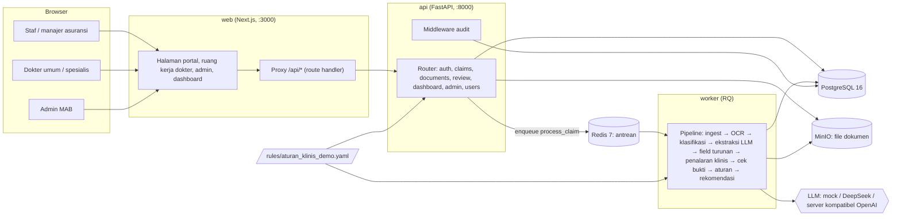
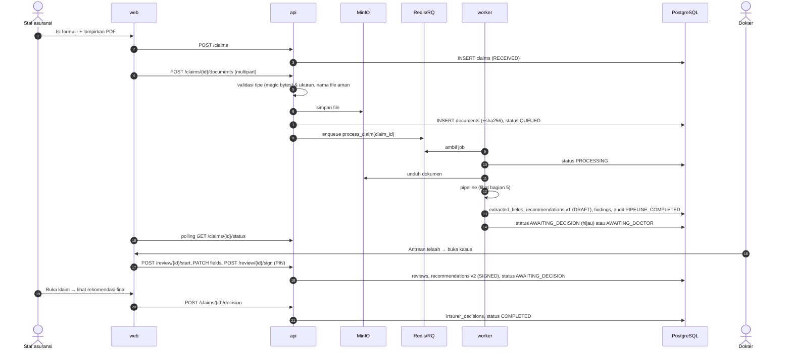
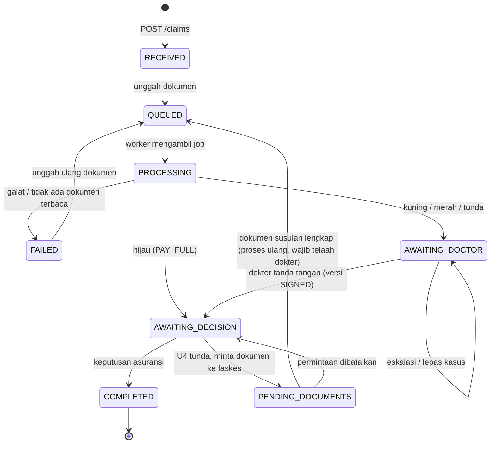

# Arsitektur MAB Indonesia POC (Tahap 0)

> **Data rekaan untuk demonstrasi.** Dokumen ini menjelaskan cara sistem dibangun. Cara menjalankan dan demo ada di [README](../README.md).

Daftar isi:

1. [Gambaran umum](#1-gambaran-umum)
2. [Teknologi yang dipakai](#2-teknologi-yang-dipakai)
3. [Service dan deployment lokal](#3-service-dan-deployment-lokal)
4. [Alur data end-to-end](#4-alur-data-end-to-end)
5. [Pipeline baca dan nilai klaim (worker)](#5-pipeline-baca-dan-nilai-klaim-worker)
6. [Mesin aturan klinis](#6-mesin-aturan-klinis)
7. [Lapisan LLM](#7-lapisan-llm)
8. [API backend](#8-api-backend)
9. [Model data](#9-model-data)
10. [Status klaim dan versi rekomendasi](#10-status-klaim-dan-versi-rekomendasi)
11. [Frontend web](#11-frontend-web)
12. [Keamanan, akses, dan audit](#12-keamanan-akses-dan-audit)
13. [Keterlacakan dan versi](#13-keterlacakan-dan-versi)
14. [Data sintetis dan evaluasi](#14-data-sintetis-dan-evaluasi)
15. [Pengujian](#15-pengujian)
16. [Keputusan desain dan batasan](#16-keputusan-desain-dan-batasan)

---

## 1. Gambaran umum

Sistem terdiri dari tiga aplikasi (web, API, worker) dan tiga layanan pendukung (PostgreSQL, Redis, MinIO), semuanya dijalankan dengan Docker Compose.



Pembagian tanggung jawab:

| Bagian | Tanggung jawab |
|---|---|
| **web** | Semua layar pengguna. Tidak menyimpan data apa pun selain token login di `localStorage`. Meneruskan semua panggilan API lewat `/api/*`. |
| **api** | Autentikasi, aturan akses per peran, simpan klaim dan dokumen, kirim job ke antrean, alur telaah dokter, keputusan asuransi, ekspor, dashboard, log audit. Tidak menjalankan OCR/LLM. |
| **worker** | Satu job per klaim (`mab_pipeline.tasks.process_claim`): membaca dokumen dari MinIO, menjalankan pipeline, menulis field, temuan, dan draf rekomendasi ke PostgreSQL. |
| **PostgreSQL** | Sumber kebenaran: pengguna, klaim, dokumen (metadata), field ekstraksi, rekomendasi berversi, temuan, telaah, keputusan, audit. |
| **Redis** | Antrean RQ `claims`. |
| **MinIO** | File asli (PDF/JPG/PNG), disimpan dengan kunci `insurer_id/claim_id/document_id/nama_file`. |

## 2. Teknologi yang dipakai

| Lapisan | Teknologi (versi terkunci) | Dipakai untuk |
|---|---|---|
| Frontend | Next.js 14.2.35 (App Router), React 18.3.1, TypeScript 5.7 (strict), Tailwind CSS 3.4 | Portal asuransi, ruang kerja dokter, admin, dashboard |
| API | Python 3.11, FastAPI 0.115.6, Uvicorn 0.34, Pydantic 2.10 + pydantic-settings 2.7 | REST API, validasi request/response, konfigurasi dari `.env` |
| ORM / migrasi | SQLAlchemy 2.0.36 (typed `Mapped[...]`), Alembic 1.14, psycopg 3.2 | Model data, migrasi skema, trigger audit |
| Autentikasi | PyJWT 2.10 (HS256), PBKDF2-SHA256 240.000 iterasi (stdlib `hashlib`) | Token login 8 jam, hash password dan PIN tanda tangan |
| Antrean | Redis 7, RQ 2.1 | Job proses klaim di latar belakang (timeout 900 detik) |
| Penyimpanan file | MinIO (S3-compatible, image `bitnamilegacy/minio`), boto3 1.35 | File dokumen klaim |
| Database | PostgreSQL 16 | Data aplikasi |
| Baca PDF | pdfplumber 0.11.4 | Teks + koordinat dari PDF digital |
| Render halaman | pypdfium2 4.30, Pillow 11.1, NumPy 1.26 | PDF pindaian → gambar 200 DPI untuk OCR; gambar pratinjau halaman |
| OCR | PaddleOCR 2.9.1 + paddlepaddle 2.6.2 (CPU), model `latin` | Teks dari halaman pindaian (hanya di image worker) |
| Pencocokan bukti | rapidfuzz 3.11 | Fuzzy match kutipan LLM ke teks dokumen |
| LLM | Klien HTTP sendiri di atas httpx 0.28 (API kompatibel OpenAI, `response_format: json_object`) | Klasifikasi dokumen, ekstraksi, penalaran klinis |
| Aturan | PyYAML 6.0 + evaluator ekspresi aman berbasis `ast` | Aturan klinis sebagai konfigurasi |
| PDF rekomendasi | fpdf2 2.8.2 + font DejaVu | Unduhan rekomendasi untuk asuransi |
| Excel | openpyxl 3.1 | Membaca `manifest.xlsx` unggah massal |
| Data sintetis | Jinja2 3.1 + WeasyPrint 63 (HTML → PDF), Pillow/NumPy (efek pindaian) | 30 klaim rekaan, PDF digital dan pindaian |
| Tes | pytest 8.3, fakeredis, SQLite in-memory, FastAPI TestClient | Tes otomatis tanpa Docker |
| Kontainer | Docker Compose v2 | Semua service dalam satu perintah |

## 3. Service dan deployment lokal

`docker-compose.yml` mendefinisikan:

| Service | Image / Dockerfile | Port | Volume / mount | Catatan |
|---|---|---|---|---|
| `postgres` | `postgres:16-alpine` | 5432 | volume `pgdata` | healthcheck `pg_isready` |
| `redis` | `redis:7-alpine` | 6379 | - | healthcheck `redis-cli ping` |
| `minio` | `bitnamilegacy/minio` | 9000 | volume `miniodata` | hanya API S3, tanpa console |
| `api` | `infra/docker/api.Dockerfile` (python:3.11-slim) | 8000 | kode, `rules/`, `data/`, `evaluation/`, `tests/` di-mount | `alembic upgrade head` lalu `uvicorn --reload` |
| `worker` | `infra/docker/worker.Dockerfile` | - | kode, `rules/`, `data/`, `evaluation/` | PaddleOCR + modelnya diunduh saat build |
| `web` | `infra/docker/web.Dockerfile` (node:20-alpine, build `standalone`) | 3000 | - | `API_INTERNAL_URL=http://api:8000` |
| `synthetic` | `infra/docker/synthetic.Dockerfile` | - | `synthetic/`, `data/` | profil `tools`, hanya dijalankan manual |
| `sftp` (U2) | `atmoz/sftp:alpine` | 2222 | `data/sftp/DEMO`, `data/sftp/PELITA` | login `demo`/`pelita`, password `demo12345` |
| `sftp-watcher` (U2) | `infra/docker/api.Dockerfile` | - | kode, `rules/`, `data/` | `python -m mab_pipeline.sftp_watcher`, memproses `data/sftp/<KODE>/masuk` |

Semua konfigurasi backend dibaca dari `.env` (template `.env.example`): koneksi database, Redis, MinIO, `JWT_SECRET`, `RULES_PATH`, `LLM_PROVIDER`/`LLM_API_KEY`/`LLM_BASE_URL`/`LLM_MODEL`, `OCR_ENGINE`/`OCR_LANG`. `.env` diabaikan git.

`make reset` menjalankan `docker compose down -v` (menghapus volume `pgdata` dan `miniodata`), menyalakan ulang, lalu `infra/scripts/seed_demo.py`.

## 4. Alur data end-to-end



## 5. Pipeline baca dan nilai klaim (worker)

Kode di `pipeline/mab_pipeline/`. Titik masuk job: `tasks.process_claim(claim_id)`. Fungsi inti bisa dipanggil tanpa database: `pipeline.read_claim(...)` (membaca dokumen) dan `pipeline.assess_claim(...)` (menilai), dipakai juga oleh skrip evaluasi.

### 5.1 Ingest (`ingest/pdf_loader.py`)

- Setiap halaman PDF dicek: bila punya lapisan teks, dibaca **pdfplumber** sebagai kata + koordinat, lalu dikelompokkan menjadi baris. Karakter watermark miring ("DATA REKAAN") dibuang dengan memeriksa matriks rotasi karakter.
- Halaman tanpa teks (pindaian) dan file JPG/PNG dirender **200 DPI** dengan pypdfium2.
- Hasilnya `LoadedDocument → PageContent → TextLine`. Setiap baris punya id stabil `D{n}-P{hal}-L{baris}`, teks, dan **bbox dalam proporsi halaman (0–1)**, sehingga bisa disorot di layar tanpa tahu resolusi aslinya.

### 5.2 Pra-pemrosesan dan OCR (`ingest/image_preprocess.py`, `ocr/engine.py`)

- Median filter (denoise), autocontrast, dan koreksi kemiringan dengan **projection profile** (mencari sudut yang membuat profil baris paling tajam).
- OCR dengan **PaddleOCR** (`OCR_ENGINE=paddle`, `OCR_LANG=latin`). Kotak kata dari OCR dikelompokkan menjadi baris dengan skor keyakinan.
- `OCR_ENGINE=none` (`NullOCREngine`) melewati halaman pindaian; halaman itu ditandai `ocr_unavailable` sehingga klaim tidak bisa hijau.

### 5.3 Klasifikasi dokumen (`ingest/doc_classifier.py`)

Urutan: kata kunci pada judul halaman pertama → bila gagal, LLM (prompt `classify_v1`) → bila tetap gagal, tebakan dari nama file. Jenis: `resume_medis`, `hasil_laboratorium`, `cppt`, `rincian_tagihan` (+ `laporan_operasi`, `resep`, `unknown`).

### 5.4 Ekstraksi (`extraction/llm_extractor.py`, `extraction/facts.py`)

- Teks dokumen dikirim sebagai **baris bernomor** (`[D1-P1-L3] ...`) bersama prompt berversi per jenis dokumen (`extraction/prompts/extract_<jenis>_v1.md` + `_common_v1.md`).
- LLM wajib menjawab JSON dan setiap nilai wajib membawa `source_line_ids`.
- Jawaban divalidasi model Pydantic (`facts.py`). Bila tidak valid, diulang sekali dengan pesan galatnya; bila tetap gagal, dokumen ditandai gagal (bukan diisi tebakan).

### 5.5 Field turunan (`extraction/derived_fields.py`)

Fungsi `derive(facts, required_docs)` menghitung field kamus data dari fakta mentah: lama rawat, trombosit terendah, kenaikan hematokrit, jumlah darah lengkap per hari, jumlah dan titer Widal, lama seftriakson, hari infus, item tagihan ganda, dokumen wajib yang kurang. **Fungsi yang sama dipakai generator data sintetis** untuk membuat kunci jawaban, jadi definisi field tidak bisa berbeda antara sistem dan evaluasi. Klaim tumpang tindih dihitung dari database (klaim lain peserta yang sama dengan tanggal rawat beririsan).

### 5.6 Penalaran klinis (`reasoning/clinical_reasoner.py`, prompt `clinical_v1`)

- Dari file aturan, sistem tahu field `sumber: ai` mana yang dipakai aturan untuk diagnosis klaim ini (mis. `clin.warning_signs`, `clin.plasma_leakage`, `clin.dehydration`).
- LLM membaca resume, CPPT, lab, dan tagihan, lalu mengisi field itu. **Setiap nilai positif wajib membawa kutipan persis** dari dokumen.

### 5.7 Cek bukti (`reasoning/evidence_check.py`)

- Setiap kutipan dicocokkan ke teks dokumen dengan rapidfuzz `partial_ratio` **≥ 0,9** pada jendela 1–3 baris berurutan (kutipan boleh melintasi baris).
- Bila cocok: field berstatus `verified` dan menyimpan bukti `{doc, page, bbox, quote, line_ids, field}`.
- Bila tidak cocok: kutipan dibuang, nilai menjadi **null = tidak diketahui** (status `unverified`). Nilai "tidak ada" (false/0/daftar kosong) diterima sebagai `absent`.

### 5.8 Aturan dan rekomendasi (`rules/`, `triage/recommender.py`)

1. Fakta klaim (field kamus data) dievaluasi oleh mesin aturan (bagian 6).
2. Setiap temuan diberi bukti dari field yang dipakai kondisinya. **Temuan yang butuh bukti AI tetapi tidak punya bukti dibuang.**
3. Skor risiko = jumlah bobot keparahan temuan (maks. 100), status triase dari tabel `triase.aturan_status`.
4. **Catatan kualitas data** mencegah klaim hijau: dokumen tidak terbaca → kuning/tunda; diagnosis tidak terbaca, AI gagal, kutipan AI tidak terbukti, aturan tidak bisa dinilai, atau temuan dibuang → kuning/perlu telaah dokter.
5. Usulan koreksi per item tagihan untuk `DUP_ITEM`, `BILLED_NOT_DOCUMENTED`, dan `LOS_EXCESS`.
6. Rekomendasi awal: `PAY_FULL` (hijau), `PEND` (dokumen kurang/tidak terbaca), atau `DOCTOR_REVIEW`. **Tidak pernah `NOT_COVERED`.**
7. Draf penjelasan dalam bahasa sederhana, rujukan pedoman, dan versi model/prompt/aturan.

### 5.9 Penyimpanan hasil (`tasks.py`)

Field ke `extracted_fields` (dengan status dan bukti), rekomendasi baru ke `recommendations` (versi lama `is_current=false`), temuan ke `findings`, audit `PIPELINE_COMPLETED`. Bila ada exception: status `FAILED`, pesan galat disimpan, audit `PIPELINE_FAILED`.

## 6. Mesin aturan klinis

File: `rules/aturan_klinis_demo.yaml` (versi `rules-2026.11-demo`, riwayat di `rules/CHANGELOG.md`). Kode: `pipeline/mab_pipeline/rules/`.

| Bagian YAML | Isi |
|---|---|
| `version`, `status` | Versi aturan (dicatat di setiap rekomendasi) dan status validasi |
| `kamus_data` | Semua field yang boleh dipakai aturan: tipe (`angka`, `teks`, `ya_tidak`, `daftar`), sumber (`dokumen`, `hitung`, `ai`), keterangan |
| `triase` | Bobot keparahan (HIGH 40, MEDIUM 20, LOW 10, INFO 0), tabel status berurutan, dokumen wajib rawat inap |
| `kode_alasan` | Kode alasan PRD + 5 tambahan, dengan label Indonesia |
| `aturan_umum` | 4 aturan lintas diagnosis: klaim tumpang tindih, item ganda, dokumen kurang, item tanpa catatan klinis |
| `diagnosis` | Per diagnosis (dengue A90/A91, tifoid A01.0, GEA A09/A08.4/A04.9/K52.9): ringkasan pedoman, `spesialisasi` penelaah, dan aturan |

Setiap aturan: `id`, `nama`, `kondisi`, `kode_alasan`, `keparahan`, `pesan` (boleh memuat `{field}`), `butuh_ai`, `rujukan`.

**Evaluator ekspresi aman** (`rules/engine.py`): `kondisi` di-parse dengan `ast` dan hanya node yang diizinkan yang boleh dipakai: akses `kelompok.field`, konstanta dan daftar, `and/or/not`, perbandingan (`== != < <= > >=`, `in`, `not in`, `is None`), dan `len()`. Tidak ada `eval`, pemanggilan fungsi lain, atau akses atribut bebas. Saat file dimuat (`rules/loader.py`), semua kesalahan dikumpulkan sekaligus: kunci wajib, id unik, field ada di kamus data, kode alasan dan keparahan dikenal, tabel triase diakhiri baris default. Aturan yang field-nya bernilai null dilewati dan dicatat (`RULE_SKIPPED`), bukan dianggap lolos.

**Aturan benefit polis (U2):** `rules/aturan_benefit_demo.yaml` memakai format dan evaluator yang sama, tetapi field-nya `policy.*` dan `benefit.*` (dihitung `mab_pipeline/benefit/` dari polis peserta + rincian tagihan). Dijalankan hanya bila tenant punya data polis; temuannya digabung dengan temuan klinis sebelum triase, dan koreksinya (selisih kamar, kelebihan limit) ditambahkan setelah koreksi klinis. Versi aturan benefit dicatat di `recommendations.benefit_ruleset_version`. Detail: [u2-integrasi-benefit.md](u2-integrasi-benefit.md).

**Aturan fraud (U3):** `rules/aturan_fraud_demo.yaml` memakai evaluator ekspresi yang sama, tetapi menilai entitas (RS, dokter, peserta, rekening, alamat, rujukan) atas seluruh data klaim tenant, bukan satu klaim. Field-nya dihitung `mab_pipeline/fraud/` (statistik sejawat, graf networkx, urutan klaim). Hasilnya sinyal dengan bukti dan skor fraud yang terpisah dari skor triase; sinyal tidak pernah mengubah klaim. Detail: [u3-fraud-analytics.md](u3-fraud-analytics.md).

**Penyesuaian per tenant (U1):** tenant tidak menulis aturan, hanya menyesuaikan: ambang skor merah/kuning (mengganti `skor_min` baris merah/kuning) dan mematikan aturan tertentu. `mab_api/tenancy.py` membuat salinan RuleSet dengan penyesuaian itu tepat sebelum pipeline menilai klaim, dan versinya diberi akhiran tenant (`+KODE.vN`).

Uji aturan dari baris perintah:

```bash
docker compose run --rm --no-deps api python -m mab_pipeline.rules rules/aturan_klinis_demo.yaml tests/fixtures/contoh_klaim_uji.json
```

## 7. Lapisan LLM

`pipeline/mab_pipeline/llm/client.py` mendefinisikan satu antarmuka:

```python
class LLMClient(Protocol):
    model_version: str
    def complete_json(self, system: str, user: str, *, task: str, context: dict) -> str: ...
```

| `LLM_PROVIDER` | Implementasi | Keterangan |
|---|---|---|
| `mock` (bawaan) | `MockLLMClient` (`llm/mock.py`) | Menjawab dari `data/synthetic_output/<nomor_klaim>/case.json`, mencari id baris yang cocok di teks dokumen (tidak peka spasi). Untuk tes, demo, dan pengembangan tanpa API key. |
| `deepseek` | `OpenAICompatibleClient` | `https://api.deepseek.com`, model `deepseek-chat`, `temperature 0`, `response_format: json_object`, retry 2x |
| `openai_compatible` | `OpenAICompatibleClient` | Server lain yang kompatibel OpenAI (`LLM_BASE_URL`, `LLM_MODEL`) |

Tiga tugas memakai LLM: `classify` (`classify_v1`), `extract` (`extract_v1`), `reason` (`clinical_v1`). Prompt disimpan sebagai file Markdown berversi di repo, dan versinya dicatat di rekomendasi (`prompt_version = extract_v1+clinical_v1`). Semua keluaran LLM diperlakukan sebagai data yang harus lolos validasi Pydantic dan cek bukti; LLM tidak pernah langsung menentukan triase atau rekomendasi.

## 8. API backend

Kode di `apps/api/mab_api/`. Dokumentasi interaktif otomatis di http://localhost:8000/docs.

| Router | Endpoint utama | Peran |
|---|---|---|
| `auth` | `POST /auth/login`, `GET /auth/me`; mode demo: `GET /auth/demo-accounts`, `POST /auth/demo-switch` | semua (ganti peran: hanya akun demo, `DEMO_MODE=true`) |
| `claims` | `POST /claims`, `POST /claims/{id}/documents`, `POST /claims/batch` (ZIP + `manifest.xlsx`), `GET /claims` (filter `status`, `triage`), `GET /claims/{id}`, `GET /claims/{id}/status`, `GET /claims/{id}/fields`, `GET /claims/{id}/recommendation`, `GET /claims/{id}/recommendation.pdf`, `POST /claims/{id}/decision`, `POST /claims/decisions/bulk-agree`, `GET /claims/export.csv` | asuransi (tulis), semua (baca sesuai akses) |
| `documents` | `GET /documents/{id}/pages/{n}.png?dpi=`, `GET /documents/{id}/download` | sesuai akses klaim |
| `review` | `GET /review/queue`, `GET /review/{id}`, `POST /review/{id}/start`, `POST /review/{id}/release`, `PATCH /review/{id}/fields/{field_id}`, `POST /review/{id}/escalate`, `POST /review/{id}/sign` | dokter (admin: baca) |
| `dashboard` | `GET /dashboard` | asuransi, TPA, auditor, admin |
| `admin` | `GET /admin/ruleset`, `POST /admin/claims/{id}/assign` | lihat aturan: admin, dokter, auditor; pindah penugasan: admin |
| `users` | `GET /users` | admin |
| `tenants` (U1) | `GET /tenants/current` (logo/nama untuk header), `GET /tenants`, `POST /tenants`, `PUT /tenants/{id}/settings`, `GET/POST /tenants/{id}/api-clients`, `POST /tenants/{id}/api-clients/{cid}/revoke` | lihat: peran tenant; ubah: admin |
| `integrations` (U1, U2) | `GET /integrations/v1/whoami`, `GET /integrations/v1/claims`, `GET /integrations/v1/claims/{nomor}`, `GET /integrations/v1/fhir/ClaimResponse/{nomor}` (`claims:read`); `POST /integrations/v1/claims` (multipart), `POST /integrations/v1/fhir` (Bundle R4) (`claims:write`); `PUT /integrations/v1/policies` (`policies:write`) | akun layanan, header `X-API-Key` |
| `integrations` demo (U2) | `POST /integrations/demo-sink/{KODE}` (penerima webhook rekaan, cek HMAC), `GET /integrations/demo-sink` | hanya `DEMO_MODE`; daftar: peran tenant |
| `policies` (U2) | `GET /policies`, `GET/PUT /policies/plans`, `POST /policies/import` (CSV/XLSX), `GET /policies/template.csv` | lihat: operator, auditor, admin; ubah: operator, admin |
| `fraud` (U3) | `GET /fraud/overview`, `GET /fraud/signals`, `GET /fraud/signals/{id}`, `GET /fraud/claims/{claim_id}`, `GET /fraud/ruleset`, `GET /fraud/records/template.csv`; `POST /fraud/runs`, `POST /fraud/records/import`, `PUT /fraud/signals/{id}/review` | lihat: operator, auditor, admin; impor/analisis/telaah: manajer klaim, admin |
| `claims` (U4) | `GET/POST /claims/{id}/document-requests`, `POST /claims/{id}/document-requests/cancel`; `POST /claims/{id}/decision` dengan `doc_types` (setuju menunda); `GET /claims?insurer_id=` | minta/batalkan: asuransi, TPA |
| `portal` (U4) | `GET /portal/claims`, `GET /portal/claims/{id}`, `POST /portal/claims/{id}/documents`; `GET /notifications`, `GET /notifications/unread-count`, `POST /notifications/{id}/read`, `POST /notifications/read-all`; `GET /tpa/summary` | portal: faskes, peserta; unggah: faskes; notifikasi: semua (milik sendiri); ringkasan TPA: TPA, admin |
| `tenants` (U2) | `GET /tenants/api-scopes`, `GET /tenants/{id}/integration-jobs`, `GET /tenants/{id}/webhook-deliveries`, `POST /tenants/{id}/webhook-deliveries/{did}/resend` | lihat: peran tenant; kirim ulang: admin |

Hak akses per peran ada di satu tempat, `rbac.py` (matriks izin, `require_perm`); cakupan data di `access.py`. Matriks lengkap di [u1-fondasi-platform.md](u1-fondasi-platform.md#3-matriks-hak-akses).

Modul pendukung: `access.py` (query klaim yang boleh dilihat per peran dan tenant), `rbac.py` (matriks izin), `tenancy.py` (pengaturan tenant dan penerapannya ke aturan), `assignment.py` (routing, penugasan otomatis, SLA), `deps.py` (pengguna saat ini, `require_perm`), `documents.py` (validasi file, sniff magic bytes PDF/JPG/PNG, nama file aman, sha256), `storage.py` (`S3Storage` untuk MinIO, `MemoryStorage` untuk tes), `job_queue.py` (RQ), `rendering.py` (PNG halaman, PDF rekomendasi), `audit.py` (middleware + pencatat manual), `ruleset.py` (aturan aktif, di-cache per proses).

Alur dokter di `routers/review.py`:

- **Routing antrean:** level `GP` untuk kuning, `SPECIALIST` untuk merah atau yang sudah dieskalasi; spesialisasi dari `diagnosis[].spesialisasi` di file aturan (atau spesialisasi tujuan eskalasi). Urut skor risiko lalu lama menunggu.
- **Penugasan (U1):** setelah draf dibuat, kasus ditugaskan otomatis ke dokter berhak dengan beban aktif paling sedikit (`assignments`, `claims.assigned_doctor_id`), kecuali tenant mematikannya. Dokter lain tidak melihat kasus yang sudah ditugaskan. Lepas kasus → dokter lain; eskalasi → spesialis. Antrean menampilkan batas SLA dan mengurutkan kasus lewat SLA lebih dulu.
- **Kunci kasus:** `start` membuat baris `reviews` (waktu mulai); bila kasus diambil dari antrean bersama, `start` juga membuat penugasan `CLAIMED`.
- **Koreksi field:** nilai asli tetap di `value`; koreksi di `corrected_value/by/at`; riwayat lengkap (lama, baru, catatan) di audit `FIELD_CORRECTED`.
- **Usulan final dari draf AI:** ada koreksi item → bayar sebagian; tidak ada → tunda/klarifikasi; tidak pernah tidak dijamin.
- **Tanda tangan:** cek PIN (salah → 403 + audit `SIGN_PIN_FAILED`); kode alasan wajib bila keputusan berbeda dari usulan; membuat versi rekomendasi baru `SIGNED` dengan temuan dan bukti disalin; `reviews.action` = `APPROVE`/`MODIFY`, `agrees_with_ai`, waktu selesai.

## 9. Model data

Tabel utama (`apps/api/mab_api/models.py`, migrasi `apps/api/alembic/versions/`):

| Tabel | Kolom penting | Keterangan |
|---|---|---|
| `insurers` | `code`, `name` | Perusahaan asuransi (tenant) |
| `users` | `email`, `role`, `insurer_id`, `specialty`, `facility_name`, `member_ref`, `password_hash`, `pin_hash`, `is_active` | Peran: `insurer_staff`, `insurer_manager`, `tpa_operator`, `doctor_gp`, `doctor_specialist`, `auditor`, `facility_officer`, `member`, `underwriter`, `admin` |
| `user_tenants` (U1) | `user_id`, `insurer_id` | Tenant tambahan yang dilayani operator TPA |
| `tenant_settings` (U1) | `display_name`, `logo_data_url`, `primary_color`, `triage_red_min_score`, `triage_yellow_min_score`, `disabled_rules[]`, `sla_gp_hours`, `sla_specialist_hours`, `auto_assign`, `version` | Pengaturan per asuransi |
| `api_clients` (U1) | `insurer_id`, `name`, `key_prefix`, `key_hash` (SHA-256), `scopes[]`, `is_active`, `last_used_at`, `revoked_at` | Akun layanan integrasi |
| `assignments` (U1) | `claim_id`, `recommendation_id`, `doctor_id`, `level`, `specialty`, `method`, `status`, `assigned_at`, `due_at`, `closed_at` | Penugasan kasus ke dokter dan batas SLA |
| `benefit_plans` (U2) | `insurer_id`, `code`, `name`, `room_class`, `room_rate_limit`, `annual_limit`, `waiting_period_days`, `excluded_icd10[]` | Plan benefit rawat inap |
| `policies` (U2) | `insurer_id`, `policy_number`, `member_id`, `member_name`, `plan_id`, `start_date`, `end_date`, `status`, `limit_used`, `source` | Polis peserta dari sistem inti asuransi |
| `integration_jobs` (U2) | `insurer_id`, `channel` (API/FHIR/SFTP/POLICY_IMPORT/POLICY_API), `reference`, `status`, `summary` | Riwayat data masuk lewat integrasi |
| `webhook_deliveries` (U2) | `insurer_id`, `event`, `claim_id`, `url`, `payload`, `status`, `attempts`, `last_status_code`, `last_error` | Webhook keluar dan hasil pengirimannya |
| `fraud_claim_records` (U3) | `insurer_id`, `claim_number`, `claim_id`, `source` (HISTORY/PLATFORM), `member_id`, `address`, `bank_account`, `hospital_name`, `doctor_name`, `referral_from`, `icd10`, tanggal, `billed_amount`, `lab_panels` | Data analitik fraud per klaim |
| `fraud_runs` (U3) | `insurer_id`, `ruleset_version`, `record_count`, `signal_count`, `entities` | Satu kali analisis fraud |
| `fraud_signals` (U3) | `run_id`, `rule_id`, `entity_type`, `entity_key`, `message`, `weight`, `claim_numbers`, `evidence` | Sinyal fraud beserta bukti |
| `fraud_reviews` (U3) | `insurer_id`, `rule_id`, `entity_key`, `status`, `notes`, `reviewed_by_id` | Telaah investigator, bertahan lintas run |
| `document_requests` (U4) | `claim_id`, `recommendation_id`, `doc_types[]`, `message`, `status` (OPEN/FULFILLED/CANCELLED), `due_at`, `fulfilled_at`, `fulfilled_by_id`, `document_ids[]` | Permintaan dokumen susulan ke faskes; klaim `PENDING_DOCUMENTS` selama OPEN |
| `notifications` (U4) | `user_id`, `claim_id`, `event`, `email`, `subject`, `body`, `delivery` (SIMULATED), `read_at` | Kotak masuk + email (disimulasikan) |

Kolom U2 lain: `claims.source` (PORTAL/BATCH/API/SFTP/FHIR), `claims.api_client_id`, `claims.policy_id`, `tenant_settings.webhook_url/webhook_secret`, `recommendations.benefit_ruleset_version`. Klaim dan dokumen dari integrasi tidak punya `created_by_id`/`uploaded_by_id`.
| `claims` | `claim_number`, `policy_number`, `member_id`, `hospital_name`, tanggal rawat, `billed_amount`, `primary_icd10`, `status`, `processing_error`, `assigned_doctor_id` | Satu klaim rawat inap |
| `documents` | `filename`, `content_type`, `size_bytes`, `sha256`, `storage_key`, `doc_type`, `page_count` | Metadata file; isi file di MinIO |
| `extracted_fields` | `field_path`, `value`, `source`, `confidence`, `status`, `evidence[]`, `corrected_value/by/at` | Satu baris per field kamus data |
| `recommendations` | `version`, `is_current`, `state` (DRAFT/SIGNED), `triage_status`, `risk_score`, `recommendation`, `billed_amount`, `recommended_amount`, `line_adjustments[]`, `guideline_refs[]`, `next_action`, `explanation_text`, `quality_flags[]`, `model_version`, `prompt_version`, `ruleset_version`, `signed_by_id`, `signed_at` | Berversi; draf AI tidak pernah ditimpa |
| `findings` | `recommendation_id`, `rule_id`, `reason_code`, `severity`, `source`, `text`, `evidence[]`, `guideline_refs[]` | Temuan per versi rekomendasi |
| `reviews` | `doctor_id`, `recommendation_id`, `action`, `reason_code`, `agrees_with_ai`, `escalated_specialty`, `notes`, `started_at`, `finished_at` | Telaah dokter; dasar metrik waktu telaah dan persetujuan |
| `insurer_decisions` | `decision` (AGREE/DIFFER), `reason`, `decided_by_id`, `decided_at` | Keputusan asuransi |
| `audit_logs` | `occurred_at`, `user_id`, `user_role`, `action`, `method`, `path`, `status_code`, `claim_id`, `document_id`, `ip_address`, `detail` | Tidak bisa di-UPDATE/DELETE (trigger PostgreSQL) |

Format bukti (`evidence`) seragam di seluruh sistem: `{doc, page, bbox: [x0, y0, x1, y1] proporsi halaman, quote, line_ids, field}`; untuk klaim tumpang tindih `{claim_id, quote}`.

Format rekomendasi untuk portal, PDF, ekspor, dan API mengikuti spesifikasi output PRD (`RecommendationOut` di `api_schemas.py`): `triage_status`, `risk_score`, `recommendation`, `billed_amount`, `recommended_amount`, `line_adjustments[]`, `findings[]` + `evidence[]`, `guideline_refs[]`, `next_action`, `reviewer`, `explanation_text`, `model_version`, `prompt_version`, `ruleset_version`, `insurer_decision`.

## 10. Status klaim dan versi rekomendasi



Aturan rilis ke asuransi (`_released_to_insurer`): rekomendasi terlihat oleh asuransi bila `recommendation == PAY_FULL` **atau** `state == SIGNED`. Selain itu endpoint rekomendasi menjawab 409 untuk peran asuransi, daftar klaim tidak menampilkan triase, dan dashboard menghitungnya sebagai "menunggu dokter".

## 11. Frontend web

Kode di `apps/web/` (Next.js App Router, semua halaman client component).

| Rute | Peran | Isi |
|---|---|---|
| `/login` | semua | Login; diarahkan ke halaman awal sesuai peran |
| `/klaim` | semua | Daftar klaim, filter status/triase, setujui massal hijau, ekspor CSV, refresh otomatis selama diproses |
| `/klaim/baru` | asuransi | Formulir satu klaim + dokumen; unggah ZIP + manifest dengan laporan per baris |
| `/klaim/[id]` | semua | Progres proses, dokumen, rekomendasi format PRD, bukti → pratinjau tersorot, keputusan, unduh PDF |
| `/telaah` | dokter | Antrean (urut risiko, filter diagnosis), tab "sudah saya tanda tangani" |
| `/telaah/[id]` | dokter, admin (baca) | Layar dua panel: dokumen asli (kiri), temuan/draf/data ekstraksi/riwayat (kanan), aksi + PIN |
| `/dashboard` | asuransi, TPA, auditor, admin | Ringkasan pilot |
| `/admin` | admin | Aturan aktif dan pengguna (baca saja) |
| `/admin/tenant` | admin | Tenant: tampilan, ambang triase, aturan aktif, SLA, penugasan otomatis; akun layanan (API key) |
| `/underwriting` | underwriter | Penanda modul U7 |

Header portal menampilkan logo dan nama tenant pengguna (`GET /tenants/current`). Menu mengikuti cerminan matriks izin di `lib/auth.tsx`; keputusan akses tetap di API.

Komponen utama di `components/`: `DocumentViewer` (`DocumentPane` inline + modal; memuat PNG halaman lewat blob URL bertoken lalu menggambar kotak sorotan dari bbox proporsional), `FindingCard`, `RecommendationView`, `ExtractedFields` (koreksi field per tipe kamus data), `ReviewActions` (setujui/ubah/eskalasi/lepas + dialog PIN), `DecisionForm`, `Badges`.

**Proxy API:** browser hanya memanggil `/api/*` di origin web. `app/api/[...path]/route.ts` meneruskan request (termasuk header `Authorization` dan body multipart) ke `API_INTERNAL_URL`. Keuntungannya: tidak perlu CORS, API tidak perlu dibuka ke publik, dan alamat API bisa diganti saat runtime tanpa build ulang.

**Sesi:** token JWT dan profil pengguna di `localStorage` (`mab_token`, `mab_user`). Respons 401 menghapus sesi dan mengarahkan ke `/login`. Pembatasan akses yang sebenarnya tetap di API; menu di web hanya menyesuaikan tampilan.

## 12. Keamanan, akses, dan audit

- **Autentikasi:** JWT HS256 (`JWT_SECRET`), kedaluwarsa 8 jam. Password dan PIN di-hash PBKDF2-SHA256 240.000 iterasi dengan salt acak.
- **Ganti peran (demo):** akun demo (`mab_api/demo.py`) bisa berpindah ke akun demo lain tanpa password lewat `POST /auth/demo-switch`, untuk menjalankan seluruh alur dari satu jendela. Bukan peran super: token baru membawa peran akun tujuan, jadi semua batasan peran tetap berlaku, dan perpindahan dicatat sebagai `DEMO_SWITCH` di log audit. Hanya aktif bila `DEMO_MODE=true`; wajib dimatikan sebelum memakai data sungguhan.
- **Isolasi tenant:** staf/manajer/auditor tenant hanya melihat klaim `insurer_id` miliknya; operator TPA hanya tenant di `user_tenants`; petugas faskes hanya klaim RS-nya; peserta hanya klaim atas nomor pesertanya. Peran tanpa aturan cakupan tidak melihat klaim apa pun. Klaim di luar akses menjawab **404**, bukan 403, supaya keberadaannya tidak bocor.
- **Draf AI:** hanya dokter dan admin yang melihat draf sebelum ditandatangani; peran lain hanya rekomendasi yang sudah dirilis.
- **Webhook (U2):** setiap pengiriman ditandatangani HMAC-SHA256 dengan rahasia per tenant (`X-MAB-Signature`), hanya berisi rekomendasi yang sudah dirilis, dan tercatat di `webhook_deliveries`. Rahasia tidak pernah dikembalikan API (hanya `webhook_secret_set`).
- **Akun layanan (U1):** kunci API acak 256-bit, hanya hash SHA-256 yang disimpan, ditampilkan sekali, bisa dicabut; terikat ke satu tenant dan cakupan izin. Setiap panggilan tercatat `INTEGRATION_ACCESS`.
- **Akses dokter:** klaim yang ditugaskan kepadanya, atau yang menunggu dokter dan belum dikunci dokter lain; antrean memfilter level dan spesialisasi.
- **Pemisahan peran:** hanya asuransi/TPA yang bisa membuat klaim dan memutuskan; hanya dokter yang bisa menelaah dan menandatangani; hanya dokter umum yang bisa mengeskalasi; auditor, faskes, dan peserta hanya-baca; admin mengatur tenant dan penugasan tetapi tidak memutuskan klaim.
- **Validasi unggahan:** tipe file dari magic bytes (bukan ekstensi), maksimum 20 MB per file dan 500 MB per ZIP, nama file disanitasi, sha256 disimpan.
- **Audit:** middleware mencatat setiap aksi tulis dan akses dokumen; endpoint mencatat kejadian penting (`LOGIN_*`, `PIPELINE_COMPLETED/FAILED`, `REVIEW_STARTED/ESCALATED/RELEASED`, `FIELD_CORRECTED`, `SIGN_PIN_FAILED`, `RECOMMENDATION_SIGNED`, dan sejak U1 `CASE_ASSIGNED`, `TENANT_CREATED`, `TENANT_SETTINGS_UPDATED`, `API_CLIENT_CREATED/REVOKED`, `INTEGRATION_ACCESS`, dan sejak U4 `DOCUMENTS_REQUESTED`, `LATE_DOCUMENTS_UPLOADED`, `DOCUMENT_REQUEST_FULFILLED/CANCELLED`). Di PostgreSQL, trigger `audit_logs_no_change` menolak UPDATE dan DELETE.
- **Rahasia:** hanya di `.env` (diabaikan git). Nilai di `.env.example` khusus lokal.
- **Data:** hanya data sintetis di Tahap 0. Sebelum memakai data nyata, cek ulang lokasi pemrosesan data penyedia LLM dan terapkan penyamaran.

## 13. Keterlacakan dan versi

Setiap rekomendasi menyimpan `model_version` (mis. `mock-llm-1` atau nama model), `prompt_version` (`extract_v1+clinical_v1`), dan `ruleset_version` (`rules-2026.11-demo`, atau dengan akhiran tenant bila tenant menyesuaikan ambang/aturan, mis. `rules-2026.11-demo+PELITA.v1`). Tanda tangan dokter membuat versi baru dan menyalin ketiga versi itu, sehingga selalu bisa dijawab: rekomendasi ini dibuat oleh model apa, prompt apa, aturan versi berapa, siapa yang menandatangani, dan apa yang diubah dari draf AI.

## 14. Data sintetis dan evaluasi

- **Generator** (`synthetic/`): `scenarios.yaml` mendefinisikan 30 skenario (16 wajar, 14 bermasalah, termasuk 2 dokumen tidak lengkap dan 1 klaim duplikat) dengan seed tetap, sehingga hasilnya sama di setiap mesin. Template Jinja2 per rumah sakit fiktif dirender ke PDF dengan WeasyPrint; 12 klaim diberi efek pindaian (dirasterisasi, miring, blur, noise, stempel). Setiap halaman bertanda "DATA REKAAN".
- **Keluaran** (`data/synthetic_output/`): PDF per klaim, `case.json`, `kunci_jawaban.csv` (status/rekomendasi/aturan yang diharapkan), `ground_truth.json` (nilai field yang benar, dihitung dengan fungsi `derive()` yang sama dengan pipeline).
- **Evaluasi** (`evaluation/run_eval.py`, `make eval`): akurasi ekstraksi per field dan per mode, kecocokan triase, klaim bermasalah yang keliru hijau, temuan berbukti, waktu proses. Laporan Markdown + JSON di `evaluation/reports/`, dengan peringatan eksplisit bila LLM mock dipakai.
- **Seed demo** (`infra/scripts/seed_demo.py`): membuat akun, klaim riwayat, mengunggah 29 klaim lewat API (SYN-DEN-09 disisakan untuk demo), menunggu worker, lalu mensimulasikan sebagian telaah dokter dan keputusan asuransi agar dashboard berisi.

## 15. Pengujian

`make test` menjalankan pytest di container api (atau lokal dengan `PYTHONPATH=apps/api:pipeline:.`). Tes memakai SQLite in-memory, `MemoryStorage`, fakeredis, dan LLM mock, jadi tidak butuh Docker atau internet.

| File | Cakupan |
|---|---|
| `tests/test_rules.py` | Validasi file aturan, evaluator aman, 30 skenario terhadap kunci jawaban |
| `tests/test_synthetic.py` | Generator data sintetis |
| `tests/test_api.py` | Auth, akses per peran dan tenant, unggah satuan/ZIP, keputusan, ekspor, audit |
| `tests/test_pipeline.py` | Ingest PDF digital/pindaian, klasifikasi, ekstraksi, field turunan |
| `tests/test_reasoning.py` | Cek bukti, penalaran klinis, rekomendasi, job worker, pratinjau halaman, PDF |
| `tests/test_review.py` | Antrean dokter, kunci kasus, koreksi + riwayat, eskalasi, PIN, versi SIGNED, rilis ke asuransi |
| `tests/test_dashboard.py` | Dashboard hanya menghitung rekomendasi yang boleh dilihat |
| `tests/test_rbac.py` | (U1) Matriks peran × endpoint, isolasi antar tenant dan antar peran, draf tersembunyi, TPA multi-tenant |
| `tests/test_tenants.py` | (U1) Ambang triase & aturan per tenant, versi aturan bertenant, audit pengaturan, API key, penugasan otomatis, SLA |
| `tests/test_u2_integrasi.py` | (U2) Aturan benefit, impor polis dan cakupannya, API klaim masuk, webhook bertanda tangan + percobaan ulang, FHIR Bundle → ClaimResponse, folder SFTP, penerima webhook demo |
| `tests/test_u4_portal.py` | (U4) SYN-TIF-10 ujung ke ujung (tunda, minta dokumen, faskes unggah, proses ulang, telaah ulang dokter yang sama, keputusan, penjelasan peserta), unggahan sebagian dan pembatalan, cakupan portal, notifikasi, ringkasan TPA |
| `tests/test_u3_fraud.py` | (U3) Validasi aturan fraud, semua pola tertanam tertangkap dengan bukti tanpa alarm palsu (beberapa seed), populasi normal tanpa sinyal, impor riwayat, Fraud Monitor + telaah + isolasi tenant, klaim platform masuk analisis tanpa mengubah klaim |

Frontend dicek dengan `npm run build` (TypeScript strict) dan uji alur di browser (Playwright) selama pengembangan.

## 16. Keputusan desain dan batasan

| Keputusan | Alasan |
|---|---|
| Aturan sebagai YAML + evaluator `ast` | Dokter/tim MAB bisa membaca dan mengubah ambang tanpa deploy kode; aman dari eksekusi kode sembarang. |
| LLM hanya mengisi fakta, bukan memutuskan | Keputusan triase deterministik dan bisa diaudit; LLM bisa diganti tanpa mengubah logika klinis. |
| Null = tidak diketahui, bukan "tidak ada" | Mencegah klaim bermasalah lolos jadi hijau karena data hilang. |
| Bukti wajib + fuzzy match ≥ 0,9 | Menahan halusinasi LLM; setiap temuan bisa ditelusuri ke halaman dan baris. |
| Rekomendasi berversi, draf tidak ditimpa | Mengukur persetujuan dokter terhadap AI dan memenuhi jejak audit. |
| Worker terpisah lewat antrean | OCR/LLM lambat tidak menahan request API; job bisa diulang. |
| Proxy `/api` di web | Satu origin untuk browser, tanpa CORS, API tetap internal. |
| `derive()` dipakai bersama generator | Definisi field identik antara sistem dan kunci jawaban. |

Batasan Tahap 0 (lihat juga README): data sintetis saja, tiga diagnosis, aturan belum divalidasi dokter, koreksi field tidak menjalankan ulang aturan, tanda tangan sederhana (login + PIN), tanpa integrasi sistem klaim asuransi, modul `redflags/` masih kosong, dan satu worker memproses klaim berurutan.
