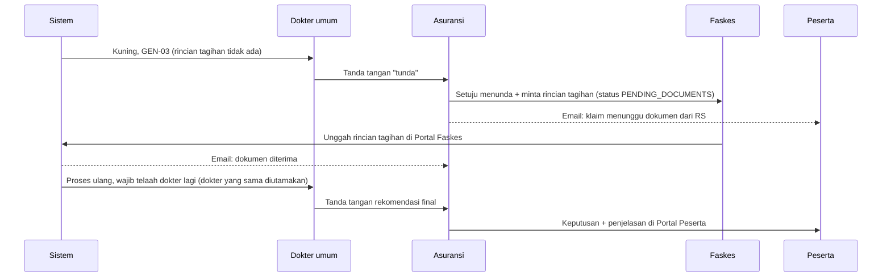

# U4 · Portal faskes, portal peserta, dan TPA

Data rekaan untuk demonstrasi.

U4 menambahkan tiga tampilan dengan login masing-masing, notifikasi email (disimulasikan selama demo),
dan alur **"tunda: minta dokumen"** yang tetap terbuka sampai dokumen susulan diterima.

| Tampilan | Akun demo | Isi |
|---|---|---|
| Portal Faskes (`/faskes`) | `faskes@demo.test` | Klaim dari RS-nya (RSU Harapan Bunda) lintas asuransi, status, linimasa, permintaan dokumen, unggah dokumen susulan |
| Portal Peserta (`/peserta`) | `peserta@demo.test` | Klaim atas nomor pesertanya: status dalam bahasa awam, linimasa, penjelasan keputusan |
| Ringkasan TPA (`/tpa`) | `tpa@mab.test` | Satu kartu per asuransi yang dilayani (DEMO dan Pelita): menunggu keputusan, menunggu dokumen, dokumen lewat batas; saring daftar klaim per asuransi |
| Kotak masuk (`/kotak-masuk`) | semua peran | Salinan email notifikasi untuk pengguna itu |

Faskes dan peserta **tidak** melihat draf AI, skor risiko, temuan, atau field hasil baca. Mereka hanya melihat
status, linimasa, permintaan dokumen, dan penjelasan setelah asuransi memutuskan.

## Alur "tunda: minta dokumen" (skenario SYN-TIF-10)

SYN-TIF-10 adalah klaim tifoid yang dikirim tanpa rincian tagihan.



Aturan alurnya:

1. **Permintaan dibuka asuransi** dengan dua cara. Cara pertama, "Setuju menunda & minta dokumen" pada rekomendasi
   PEND yang sudah ditandatangani dokter. Cara kedua, tombol "Tunda & minta dokumen" pada rekomendasi lain yang
   belum diputuskan; cara ini tidak mencatat keputusan. Klaim menjadi `PENDING_DOCUMENTS` dan tidak bisa
   diputuskan.
2. **Permintaan tetap OPEN sampai semua jenis dokumen yang diminta ada di klaim.** Unggahan sebagian disimpan,
   dan sisanya terlihat sebagai "masih kurang". Faskes memilih jenis tiap file. Asuransi juga bisa
   mengunggah sendiri bila dokumen sudah ada padanya.
3. **Setelah lengkap**, permintaan menjadi FULFILLED dan klaim masuk antrean proses ulang. Pipeline membuat draf
   baru. Draf ini **selalu** masuk antrean dokter, walau hasilnya bayar penuh, karena dokter yang menunda perlu
   melihat dokumen yang dimintanya. Kasus ditugaskan ke dokter yang menandatangani "tunda" bila dokter itu
   masih berhak (level dan spesialisasi sama). Bila tidak, penugasan otomatis biasa.
4. Keputusan "tunda" lama terikat ke rekomendasi lama. Setelah proses ulang, klaim dianggap belum diputuskan
   sampai asuransi mencatat keputusan atas rekomendasi baru.
5. Asuransi bisa membatalkan permintaan yang dibuka tanpa keputusan. Klaim kembali menunggu keputusan.
6. Permintaan punya batas waktu (bawaan 7 hari, 1 sampai 30). Permintaan yang lewat batas ditandai merah di
   portal dan dihitung di Ringkasan TPA.

Semua langkah tercatat di log audit: `DOCUMENTS_REQUESTED`, `LATE_DOCUMENTS_UPLOADED`,
`DOCUMENT_REQUEST_FULFILLED`, `DOCUMENT_REQUEST_CANCELLED`, dan `PIPELINE_COMPLETED` dengan
`after_late_documents: true`.

## Notifikasi email (disimulasikan)

`mab_api/notify.py` membuat satu baris `notifications` per penerima, dengan `delivery=SIMULATED`. Email
**tidak dikirim** selama demo. Isinya bisa dibaca di Kotak masuk. Untuk SMTP sungguhan, cukup ganti `_deliver`.

| Peristiwa | Penerima |
|---|---|
| `claim.documents_requested` | Petugas faskes RS klaim, peserta pemilik klaim |
| `claim.documents_received` | Staf dan manajer asuransi pemilik klaim, operator TPA yang melayaninya, peserta |
| `claim.recommendation_released` | Peserta |
| `claim.decision_recorded` | Peserta, petugas faskes |

Webhook ke sistem asuransi mendapat peristiwa baru `claim.documents_requested`.

## API

| Endpoint | Peran |
|---|---|
| `POST /claims/{id}/decision` dengan `doc_types[]`, `message` (setuju pada rekomendasi PEND) | asuransi, TPA |
| `GET /claims/{id}/document-requests` | sesuai akses klaim |
| `POST /claims/{id}/document-requests` (`doc_types[]`, `message`, `due_days`) | asuransi, TPA |
| `POST /claims/{id}/document-requests/cancel` | asuransi, TPA |
| `POST /claims/{id}/documents` saat `PENDING_DOCUMENTS` (multipart `files` + `doc_types`) | asuransi, TPA |
| `GET /claims?insurer_id=` | saring per asuransi (TPA) |
| `GET /portal/claims`, `GET /portal/claims/{id}` | faskes, peserta |
| `POST /portal/claims/{id}/documents` (multipart `files`, `doc_types`, `note`) | faskes |
| `GET /notifications`, `GET /notifications/unread-count`, `POST /notifications/{id}/read`, `POST /notifications/read-all` | semua peran (miliknya sendiri) |
| `GET /tpa/summary` | operator TPA, admin |

Izin baru di `rbac.py`: `PORTAL_VIEW` (faskes, peserta), `FACILITY_UPLOAD` (faskes), `TPA_OVERVIEW` (TPA, admin).

## Database (migrasi `0006`)

| Tabel | Kolom utama |
|---|---|
| `document_requests` | `claim_id`, `insurer_id`, `recommendation_id`, `doc_types[]`, `message`, `status` (OPEN/FULFILLED/CANCELLED), `requested_by_id`, `due_at`, `fulfilled_at`, `fulfilled_by_id`, `document_ids[]`, `response_note` |
| `notifications` | `user_id`, `insurer_id`, `claim_id`, `event`, `email`, `subject`, `body`, `delivery` (SIMULATED), `read_at` |

Status klaim baru: `PENDING_DOCUMENTS`.

## Demo

1. Ambil kode terbaru dan buat ulang data. Generator sekarang juga membuat dokumen susulan
   `data/synthetic_output/SYN-TIF-10/susulan/rincian_tagihan.pdf`:
   ```powershell
   git pull origin dev
   docker compose down -v
   docker compose up -d --build
   docker compose run --rm --build synthetic
   docker compose exec -T api python infra/scripts/seed_demo.py
   ```
   Di akhir seed, SYN-TIF-10 sudah ditunda dokter dan asuransi sudah meminta rincian tagihan.
2. Masuk sebagai `peserta@demo.test`. Klaim SYN-TIF-10 berstatus "Menunggu dokumen dari rumah sakit", dan Kotak
   masuk berisi email pemberitahuannya.
3. Ganti peran ke **Petugas faskes**. Portal Faskes menaruh SYN-TIF-10 paling atas. Buka klaimnya, pilih file
   `data\synthetic_output\SYN-TIF-10\susulan\rincian_tagihan.pdf` pada "Rincian tagihan", lalu kirim.
4. Tunggu worker memproses ulang (beberapa detik sampai satu menit). Ganti peran ke **Dokter umum**. SYN-TIF-10
   muncul lagi di antrean, sudah ditugaskan ke dokter yang sama. GEN-03 hilang, dan tagihan kini dinilai aturan.
   Telaah lalu tanda tangan.
5. Ganti peran ke **Staf klaim**. Kotak masuk berisi email "dokumen susulan sudah diterima". Detail klaim
   menampilkan riwayat permintaan. Catat keputusan.
6. Kembali ke **Peserta**. Status "Selesai", ada penjelasan keputusan, nama dokter penelaah, dan linimasa lengkap.
7. Masuk sebagai `tpa@mab.test` untuk melihat Ringkasan TPA kedua asuransi. "Lihat klaim" menyaring daftar klaim
   per asuransi.

## Batasan POC

- Email hanya disimulasikan. Belum ada SMTP, templat HTML, atau preferensi notifikasi per pengguna.
- Faskes dikenali dari nama RS yang sama persis dengan `hospital_name` klaim. Data sungguhan butuh kode faskes.
- Peserta dikenali dari `member_id` + asuransi. Login peserta sungguhan butuh verifikasi identitas (mis. OTP).
- Batas waktu permintaan hanya ditandai. Belum ada pengingat otomatis atau penutupan klaim saat lewat batas.
- Faskes belum bisa melihat isi dokumen klaimnya di portal. Saat ini hanya daftar file.
