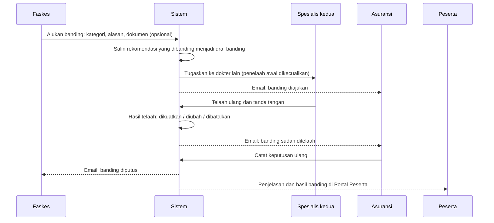

# U5 · Manajemen sengketa (banding)

Data rekaan untuk demonstrasi.

U5 memungkinkan faskes atau peserta mengajukan **banding** atas keputusan klaim. Banding ditelaah ulang oleh
**dokter yang berbeda dari penelaah awal**, lalu asuransi memutus ulang. Hasilnya dicatat sebagai
**dikuatkan**, **diubah**, atau **dibatalkan**, dan seluruh jejaknya tercatat di log audit.

| Tampilan | Siapa | Isi |
|---|---|---|
| Portal Faskes / Peserta, detail klaim | faskes, peserta | Form banding (kategori, alasan, dokumen pendukung), status banding, tarik banding, riwayat, hasil |
| Antrean telaah | dokter | Label **banding**; kasus banding ditugaskan ke dokter lain dan tidak muncul di antrean penelaah awal |
| Ruang telaah | dokter | Banner banding: alasan, pengaju, kategori, keputusan yang dibanding, penelaah awal |
| Detail klaim | asuransi, TPA, auditor | Kartu Banding dengan riwayat lengkap (penelaah awal, penelaah ulang, rekomendasi lama dan baru) |
| Dashboard | manajer, auditor, admin | Metrik banding: terbuka, lewat SLA, selesai, persentase keputusan berubah, rata-rata hari, hasil, kategori |

Faskes dan peserta tidak melihat draf AI, skor risiko, atau temuan. Mereka melihat status, alasan, hasil, nama dokter
penelaah, dan pertimbangan telaah ulang setelah banding diputus.

## Alur (skenario SYN-GEA-06)

SYN-GEA-06 adalah rawat inap dehidrasi ringan-sedang di RSU Harapan Bunda. Seed membuat spesialis pertama
menandatangani **tidak dijamin** (ADMISSION_NOT_INDICATED), dan asuransi setuju.



Aturan alurnya:

1. **Siapa dan kapan.** Petugas faskes RS klaim atau peserta pemilik klaim bisa mengajukan banding bila klaim
   sudah diputuskan asuransi (`COMPLETED`). Keputusan "bayar penuh" yang disetujui asuransi tidak bisa
   dibanding. Batas pengajuan **30 hari** sejak keputusan.
2. **Isi banding.** Kategori (penilaian medis, penjaminan / polis, nilai pembayaran, lainnya), alasan minimal
   10 karakter, dan dokumen pendukung opsional (PDF/JPG/PNG, jenis dipilih per file). Dokumen masuk ke
   daftar dokumen klaim.
3. **Satu banding terbuka per klaim, satu tingkat.** Selama banding berjalan, banding baru ditolak. Setelah
   banding diputus, keputusan akhir tidak bisa dibanding lagi. Banding yang ditarik tidak dihitung.
4. **Telaah ulang oleh dokter lain.** Sistem membuat draf baru (salinan rekomendasi yang dibanding) dengan
   penanda kualitas `DISPUTE`. Klaim kembali ke `AWAITING_DOCTOR` di level **spesialis**. Penelaah awal
   dikecualikan dari penugasan otomatis, tidak bisa memulai telaah, dan admin tidak bisa memindahkan kasus
   kepadanya. Bila spesialis lain belum ada, kasus menunggu di antrean tanpa penugasan.
5. **Hasil telaah** ditentukan dari tanda tangan dokter kedua:
   - **Dikuatkan**: kode dan nilai sama dengan rekomendasi yang dibanding.
   - **Dibatalkan**: rekomendasi baru "bayar penuh".
   - **Diubah**: selain itu (mis. tidak dijamin menjadi bayar sebagian).
   Banding lalu menunggu putusan ulang asuransi. Mengubah ke "bayar penuh" tidak butuh kode alasan
   penolakan, tetapi pertimbangan dokter wajib ditulis. Pertimbangan ini dibaca pengaju setelah banding diputus.
6. **Putusan ulang.** Asuransi mencatat keputusan atas rekomendasi baru seperti biasa (setuju / berbeda).
   Banding menjadi `RESOLVED` dengan hasil final, dan klaim kembali `COMPLETED`.
7. **Tarik banding.** Pengaju bisa menarik banding selama masih ditelaah dokter. Keputusan awal kembali
   berlaku dan klaim kembali `COMPLETED`.
8. **SLA 14 hari** sejak banding diajukan. Banding yang lewat SLA ditandai merah dan dihitung di Dashboard.

Tidak ada status klaim baru. Status banding: `IN_REVIEW`, `AWAITING_DECISION`, `RESOLVED`, `WITHDRAWN`.

Log audit: `DISPUTE_FILED`, `DISPUTE_REVIEWED`, `DISPUTE_RESOLVED` (dengan `on_time`), `DISPUTE_WITHDRAWN`,
ditambah `RECOMMENDATION_SIGNED` dan `INSURER_DECISION` seperti biasa.

## Notifikasi email (disimulasikan)

| Peristiwa | Penerima |
|---|---|
| `claim.dispute_filed` | Staf dan manajer asuransi pemilik klaim, operator TPA yang melayaninya; pengaju (tanda terima); pihak portal lainnya (faskes atau peserta) |
| `claim.dispute_reviewed` | Staf dan manajer asuransi, operator TPA |
| `claim.dispute_resolved` | Petugas faskes RS klaim, peserta pemilik klaim |

Webhook ke sistem asuransi mendapat peristiwa baru `claim.dispute_filed` dan `claim.dispute_resolved`.

## API

| Endpoint | Peran |
|---|---|
| `POST /portal/claims/{id}/disputes` (multipart `category`, `reason`, `files`, `doc_types`) | faskes, peserta |
| `POST /portal/claims/{id}/disputes/withdraw` | pengaju banding |
| `GET /claims/{id}/disputes` | sesuai akses klaim |
| `GET /disputes?status=` (`OPEN`, `IN_REVIEW`, `AWAITING_DECISION`, `RESOLVED`, `WITHDRAWN`) | staf, manajer, TPA, auditor, admin |
| `GET /dashboard` | kini berisi `disputes` (metrik banding) |

Respons portal kini berisi `open_dispute`, `can_dispute`, `dispute_blocked_reason`, dan `disputes`.
Izin baru di `rbac.py`: `DISPUTE_FILE` (faskes, peserta) dan `DISPUTE_VIEW` (staf, manajer, TPA, auditor, admin).

## Database (migrasi `0007`)

| Tabel / kolom | Isi |
|---|---|
| `disputes` | `claim_id`, `insurer_id`, `decision_id`, `disputed_recommendation_id`, `original_reviewer_id`, `raised_by_id`, `raised_by_role`, `category`, `reason`, `document_ids[]`, `status`, `due_at`, `review_recommendation_id`, `reviewer_id`, `reviewed_at`, `review_outcome`, `review_notes`, `new_recommendation_id`, `final_decision_id`, `outcome`, `resolved_at`, `resolved_by_id` |
| `recommendations.dispute_id` | Rekomendasi hasil telaah banding |
| `recommendations.excluded_reviewer_id` | Dokter yang tidak boleh menelaah (penelaah awal) |

## Demo

1. Ambil kode terbaru dan buat ulang data:
   ```powershell
   git pull origin dev
   docker compose down -v
   docker compose up -d --build
   docker compose run --rm --build synthetic
   docker compose exec -T api python infra/scripts/seed_demo.py
   ```
   Di akhir seed, SYN-GEA-06 (Asuransi Sehat Demo) sudah diputus "tidak dijamin".
2. Masuk sebagai `faskes@demo.test`. Buka SYN-GEA-06 milik Asuransi Sehat Demo. Di kartu **Banding**, klik
   "Ajukan banding", pilih "Penilaian medis", tulis alasan (mis. "Pasien muntah terus dan tidak bisa minum,
   tercatat di CPPT hari pertama"), lalu kirim.
3. Ganti peran ke **Dokter spesialis** (`dokter.spesialis@mab.test`). SYN-GEA-06 tidak muncul di antreannya,
   karena dia penelaah awal. Kasus sudah ditugaskan ke spesialis kedua.
4. Ganti peran ke **Dokter spesialis kedua** (`dokter.spesialis2@mab.test`). Kasus sudah ditugaskan kepadanya.
   Banner banding menampilkan alasan faskes. Pilih "Ubah", ganti menjadi bayar penuh, tulis pertimbangan
   telaah ulang (kode alasan tidak wajib untuk membatalkan), lalu tanda tangan dengan PIN.
5. Ganti peran ke **Staf klaim**. Kartu Banding di detail klaim menunjukkan hasil telaah ulang. Catat keputusan.
6. Kembali ke **Petugas faskes**: status "Selesai", hasil "keputusan awal dibatalkan", linimasa banding lengkap.
   Banding kedua tidak bisa diajukan.
7. Masuk sebagai `manajer@demo.test`. Dashboard menampilkan metrik banding.

## Batasan POC

- Banding hanya satu tingkat dan ditelaah satu dokter. Belum ada panel dokter atau mediasi.
- Telaah ulang selalu di level spesialis bidang yang sama. Belum ada pilihan spesialisasi lain.
- SLA banding tetap 14 hari dan batas pengajuan 30 hari untuk semua tenant. Belum bisa diatur per tenant.
- Belum ada pengingat otomatis saat banding mendekati atau lewat SLA.
